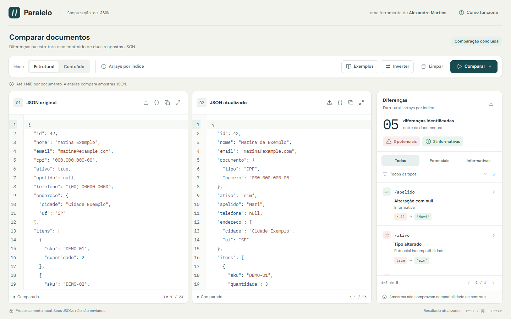

# Paralelo

Bancada web para comparar dois exemplos JSON, inspecionar diferenças e exportar um relatório Markdown. O processamento acontece **localmente no navegador**, em um Web Worker. Não há backend, conta ou envio de documentos.



## Executar

Requer Node.js 24 LTS e npm. As dependências têm versões fixas e um único lockfile.

```sh
npm ci
npm run dev
```

Abra http://127.0.0.1:5184/. A porta é fixa para evitar abrir outra aplicação por engano.

Para gerar e experimentar o artefato de produção:

```sh
npm run build
npm run preview
```

O preview usa http://127.0.0.1:4184/. Para encerrar o dev ou o preview, use **Ctrl+C no terminal que o iniciou**.

A saída está em `dist/`, ignorada no Git. Pode ser hospedada como arquivos estáticos, servindo os arquivos JavaScript do Worker com seu tipo correto. Use HTTPS em produção, inclusive para acesso ao clipboard. Não é necessário ASP.NET, SignalR ou WebSockets; o WebSocket de HMR existe apenas no desenvolvimento do Vite. Publicação remota permanece fora desta entrega.

## Utilizar

A primeira visita abre o exemplo fictício de cadastro já comparado. Os exemplos de cadastro, webhook e configuração substituem os dois documentos, preservam o modo e executam uma comparação real.

- **Estrutural:** identifica propriedades, tipos, transições envolvendo null e diferenças nos arrays. Ignora mudanças comuns de valores escalares.
- **Conteúdo:** acrescenta mudanças de valores escalares, com igualdade numérica exata.
- Após alterar os documentos ou o modo, clique em **Comparar**, ou use Ctrl/Cmd+Enter na bancada. Comparar novamente um resultado atual ou recarregar o mesmo exemplo intacto preserva os filtros e a seleção, sem refazer a operação. O resultado anterior continua consultável, com indicação de desatualização; localização e exportação ficam bloqueadas.
- Cada editor permite importar `.json` em UTF-8 com ou sem BOM, formatar, copiar, ampliar, desfazer/refazer e localizar valores completos. Tab permite sair do editor.
- O inspector combina os filtros de classificação e tipo, com páginas de 25 diferenças. O drawer navega pelo conjunto filtrado, inclusive entre páginas.
- **Exportar Markdown** inclui todas as diferenças da comparação atual, independentemente dos filtros. Ausência, JSON null e prévias truncadas são identificados.
- Durante processamento, os documentos e as ações concorrentes são bloqueados imediatamente. O indicador aparece apenas após 150 ms, evitando piscadas em operações rápidas. **Cancelar** interrompe o Worker. Após 10 segundos, a operação é interrompida automaticamente; falhas permitem tentar uma nova operação, preservando os documentos.

## Regras de comparação

Qualquer raiz JSON válida é aceita. A comparação ignora espaços e ordem das propriedades; os nomes são comparados de forma ordinal e sensível a maiúsculas. Comentários, vírgulas finais, propriedades duplicadas após decodificação e sequências Unicode com substitutos isolados são rejeitados. Erros informam lado, linha e coluna sem expor trechos ou nomes de propriedades.

Números são comparados a partir dos tokens originais, normalizando sinal, dígitos significativos e expoente inteiro com BigInt. O valor numérico produzido pelo parser não é usado: `9007199254740992` e `9007199254740993` são distintos; `1.2300` e `123e-2` são equivalentes; `-0` e `0` também. Expoentes não são expandidos em sequências de zeros.

Arrays são comparados **por índice**, inclusive quando heterogêneos ou aninhados. Reordenações podem gerar diferenças; não há detecção de movimentação, associação por identidade ou inferência de schema de arrays vazios. Uma subárvore adicionada/removida ou substituição de tipo gera uma diferença, sem repetir seus descendentes. A saída é determinística e usa JSON Pointer; a raiz é exibida como “(raiz)”.

| Evidência observada                                                    | Classificação               |
| ---------------------------------------------------------------------- | --------------------------- |
| Propriedade removida ou tipo alterado                                  | Potencial incompatibilidade |
| Valor concreto → null                                                  | Potencial incompatibilidade |
| null → valor concreto                                                  | Informativa                 |
| Propriedade adicionada, elemento adicionado/removido ou valor alterado | Informativa                 |

São evidências de **amostras**, não prova de mudança contratual ou quebra efetiva. “Informativa” também não garante compatibilidade. Ausência é diferente de null.

A formatação usa dois espaços e quebras LF, mantendo a ordem e os tokens originais de strings e números. Se a entrada for inválida ou a saída exceder o limite, o editor permanece integralmente preservado. Não se usa JSON.parse/JSON.stringify para transformar os documentos da aplicação.

## Limites e privacidade

| Recurso                             | Limite                                             |
| ----------------------------------- | -------------------------------------------------- |
| Cada documento, inclusive formatado | 1 MiB em UTF-8                                     |
| Profundidade                        | 64 níveis de objetos/arrays                        |
| Diferenças                          | 1.000                                              |
| Prévia de cada valor                | 512 unidades UTF-16, sem dividir pares substitutos |
| Textos acumulados no resultado      | 4 MiB em UTF-8                                     |
| Relatório Markdown                  | 8 MiB em UTF-8                                     |
| Tempo de uma operação no Worker     | 10 segundos                                        |

Os limites são centralizados em `src/core/limits.ts`. Exceder limites nunca produz equivalência ou resultado parcial. O relatório protege conteúdo arbitrário com delimitadores de bloco seguros; não é renderizado como HTML na aplicação.

Os documentos ficam somente em memória na aba. Não há localStorage, sessionStorage, cookies, histórico, telemetria ou persistência de payloads. Recarregar a página restaura o exemplo inicial. Abas/sessões independentes não compartilham documentos.

## Interface

A POC preservada em `reference/api-diff-poc.html` orienta composição, cores e interações. Seu algoritmo não foi transportado.

| Largura              | Organização                             |
| -------------------- | --------------------------------------- |
| A partir de 1.021 px | Dois documentos e inspector lateral     |
| 721–1.020 px         | Abas Documentos / Diferenças            |
| Até 720 px           | Abas Original / Atualizado / Diferenças |

As instâncias CodeMirror permanecem montadas: texto, seleção, histórico e rolagem sobrevivem à alternância de abas, expansão e redimensionamento. Drawers têm contenção/restauração de foco, Escape e ancoragem nas bordas. Movimentos curtos respeitam a preferência por movimento reduzido. DM Sans e IBM Plex Mono são locais, com licenças em `public/fonts/`. Logo e favicon compartilham o mesmo SVG com barras inclinadas.

“Arrays por índice” abre uma única explicação por clique, Enter, Space ou toque, com fechamento por Escape ou clique externo. O filtro de tipo usa Select estilizado sobre Radix, com navegação por teclado.

## Testar

```sh
npm test
npm run typecheck
npm run build
npx playwright install chromium firefox webkit
npm run test:e2e
```

Vitest cobre motor, limites, relatórios, ciclo de vida do Worker e estados da bancada. Playwright usa o artefato de produção e CodeMirror real: execute o build antes. Reutiliza o preview local da porta 4184 ou o inicia quando necessário. A suíte completa roda em Chromium; Firefox e WebKit executam um fluxo integrado de comparação, formatação, localização, filtros e download.

Casos, resultados, capturas e limites da validação estão em [docs/validation.md](docs/validation.md).

## Código

React 19, TypeScript estrito, Vite, Tailwind 4, CodeMirror 6, Lucide e componentes shadcn seletivos sobre Radix. Sem framework de estado ou transporte.

- `src/core`: validação estrita sobre jsonc-parser 3.3.1, números exatos, comparação, formatação e Markdown; sem React.
- `src/workers`: um Worker nativo e cliente concreto com identificação/revisão, cancelamento, timeout e recriação após falha.
- `src/app`: composição e estado local da bancada.
- `src/components`: editores, inspector e componentes visuais.
- `src/demo`: apenas documentos fictícios e metadados dos exemplos. Resultados vêm do motor.
- `src/test/fixtures`: resultados esperados fixos dos exemplos, usados somente pelos testes.
- `tests/e2e`: fluxos no navegador.

## Limitações conhecidas

- Analisa exemplos JSON, não contratos OpenAPI ou schemas. Não inclui V2, persistência, autenticação ou histórico.
- Clipboard depende do contexto seguro e da permissão do navegador; falhas têm feedback e os documentos continuam disponíveis para cópia manual.
- Operações muito custosas podem atingir o timeout conforme documento e hardware. O cancelamento termina a thread e uma nova operação cria outra.
- O valor completo permanece selecionável; o realce adicional por linha é limitado às primeiras 200 linhas do valor para conter trabalho de decoração.
- Testes automatizados não substituem auditoria manual com leitores de tela, dispositivos físicos e zoom nativo em todos os navegadores.
- O build passa com aviso de chunk principal acima de 500 kB: aproximadamente 235 KiB gzip, mais Worker de 22 kB sem compressão. Não foi adicionado fracionamento artificial para silenciar esse aviso.

## Preservação da implementação anterior

- `archive/dotnet-v1`: estado completo do workspace .NET, commit `36ed3ee`.
- `archive/dotnet-rar`: os 41 arquivos não gerados do RAR original, commit `cf55343`, com origem documentada em `ARCHIVE.md` nessa branch.
- `main`: aplicação React ativa, sem dependência do código .NET.

A comparação do RAR encontrou 29 arquivos idênticos ao workspace e 12 diferentes, sem arquivos ausentes. Seu snapshot foi conferido byte a byte; arquivos gerados e redundantes foram excluídos. O RAR local continua intacto e ignorado.

```sh
git log --oneline archive/dotnet-v1
git show archive/dotnet-rar:ARCHIVE.md
git archive --format=zip --output=dotnet-v1.zip archive/dotnet-v1
```

As branches são preservação local no mesmo repositório; não substituem um backup externo. Não há remoto configurado ou publicação remota realizada.
